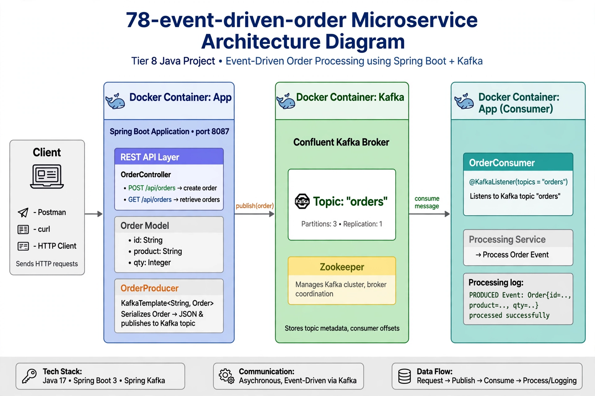
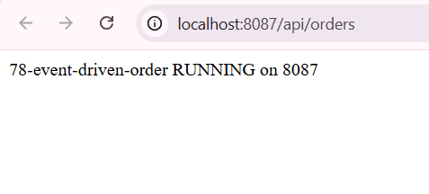
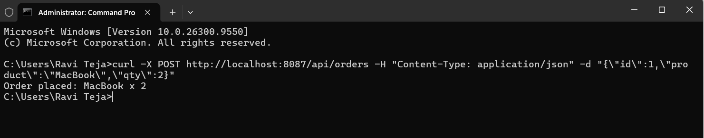

# 🎯 Project 78 – Event-Driven Order Service | Spring Boot + Kafka + Docker | Port 8087

<p align="left">


</p>

## 📖 Project Overview

Project 78 is Tier 8 – Advanced Backend – Event-Driven Order Service, built with Spring Boot 4.1.1, Spring Kafka 3.3.0, Confluent Kafka 7.4.0, Zookeeper, Lombok, Port 8087 + 9092 + 2181.

This project uses **EVENT-DRIVEN with KAFKA – PRODUCER / CONSUMER PATTERN**:

- Order Service runs on port 8087 – http://localhost:8087/api/orders – RUNNING on 8087
- Kafka Broker runs on port 9092 – Confluent Kafka – Topic: orders – Partitions: 3 – Replication: 1
- Zookeeper runs on port 2181 – Manages Kafka cluster
- Docker Compose – 3 Containers – zookeeper + kafka + 78-event-driven-order-app
- 2 APIs – GET /api/orders -> 78-event-driven-order RUNNING on 8087 – demo1.png
- POST /api/orders -> Order placed: MacBook x 2 – Event Fired – demo2.png

Backend flow:
- POST /api/orders with JSON {"id":1,"product":"MacBook","qty":2} -> OrderController
- OrderController -> orderProducer.send(order) -> KafkaTemplate -> publishes to topic orders
- Kafka Broker – Topic: "orders" – Stores event
- OrderConsumer – @KafkaListener(topics="orders") – consume message -> Processing log: PRODUCED Event

Verified with 2 screenshots:
- demo1.png – Browser – localhost:8087/api/orders – GET – 78-event-driven-order RUNNING on 8087
- demo2.png – CMD curl – POST – Order placed: MacBook x 2


## 🏗 Architecture Diagram – Event-Driven – Request -> Publish -> Consume



```text
Client (curl/Postman/Browser) -> REST API Layer OrderController 8087 (GET RUNNING, POST Order placed)
 -> Order Model id,product,qty -> OrderProducer KafkaTemplate publish(order) -> Kafka Broker 9092 Topic: orders Partitions 3 Replication 1
 -> Zookeeper 2181 manages cluster -> OrderConsumer @KafkaListener consumes -> Processing Service -> Processing log PRODUCED Event
 -> Response Order placed: MacBook x 2
```

Data Flow: Request -> Publish -> Consume -> Process/Logging – Async – Event-Driven
Tech Stack: Java 17 + Spring Boot 3 + Spring Kafka + Confluent Kafka 7.4.0 + Zookeeper + Docker Compose
```


## ✨ Features

### 🌐 REST API Layer – 8087
- OrderController – Port 8087 – @RestController @RequestMapping("/api/orders")
- GET /api/orders -> RUNNING on 8087 – Health check – demo1.png
- POST /api/orders -> Order placed: MacBook x 2 – demo2.png
- Order Model – id, product, qty – Lombok @Data

### 📡 Kafka Producer – Event Publishing
- OrderProducer – KafkaTemplate<String, Order> – kafkaTemplate.send("orders", order)
- Logs >>> PRODUCED Event: Order{id=.., product=.., qty=..}
- Confluent Kafka 7.4.0 – Broker Port 9092 – Partitions 3 Replication 1

### 📥 Kafka Consumer – Event Listening
- OrderConsumer – @KafkaListener(topics="orders") – Listens topic orders
- Processing log: PRODUCED Event processed successfully
- Future: 79-Notification-Service will listen same topic

### 🐳 Docker + Docker Compose
- Dockerfile – OpenJDK 17 – EXPOSE 8087
- docker-compose.yml – zookeeper:2181, kafka:9092, app:8087
- 3 containers – depends_on – zookeeper -> kafka -> app

## 🛠 Technologies Used

| Technology | Version | Purpose |
|---|---|---|
| Java | 17 | Backend |
| Spring Boot | 4.1.1 | 78-event-driven-order – Port 8087 |
| Spring Kafka | 3.3.0 | Producer/Consumer |
| Confluent Kafka | 7.4.0 | Broker – Topic orders – 9092 |
| Zookeeper | 7.4.0 | Cluster – 2181 |
| Lombok | Default | Order model |
| Docker | Latest | Containerize |
| Docker Compose | Latest | 3 containers |
| Maven | mvnw.cmd | Build |

## 📂 Project Structure

```text
78-event-driven-order/
├── src/main/java/com/order/event/
│   ├── EventDrivenOrderApplication.java – Port 8087
│   ├── controller/OrderController.java – GET RUNNING, POST Order placed + Producer
│   ├── model/Order.java – id, product, qty
│   ├── producer/OrderProducer.java – KafkaTemplate send orders
│   └── consumer/OrderConsumer.java – @KafkaListener orders
├── src/main/resources/
│   ├── application.yml – server.port 8087, kafka bootstrap localhost:9092
│   └── README.md
├── screenshots/
│   ├── demo1.png – Browser GET RUNNING on 8087
│   └── demo2.png – CMD curl POST Order placed
├── Dockerfile
├── docker-compose.yml
└── pom.xml
```

## ▶ How to Run

### 1. Clone
```bash
git clone https://github.com/raviteja-dev950/78-event-driven-order.git
cd 78-event-driven-order
```

### 2. Application YML – FINAL

**application.yml – 8087 + Kafka**
```yaml
server:
  port: 8087
spring:
  application:
    name: 78-event-driven-order
  kafka:
    bootstrap-servers: localhost:9092
    producer:
      key-serializer: org.apache.kafka.common.serialization.StringSerializer
      value-serializer: org.springframework.kafka.support.serializer.JsonSerializer
    consumer:
      group-id: order-group
      key-deserializer: org.apache.kafka.common.serialization.StringDeserializer
      value-deserializer: org.springframework.kafka.support.serializer.JsonDeserializer
      properties:
        spring.json.trusted.packages: "*"
```

### 3. Run – Docker Compose

```bash
mvn clean package -DskipTests
docker-compose up --build
# Wait: zookeeper 2181 – kafka 9092 – app 8087 – All UP
```

### 4. Backend Logic

```java
@RestController
@RequestMapping("/api/orders")
public class OrderController {
    @Autowired OrderProducer producer;
    @GetMapping
    public String health() { return "78-event-driven-order RUNNING on 8087"; }
    @PostMapping
    public String placeOrder(@RequestBody Order order) {
        producer.send(order);
        return "Order placed: " + order.getProduct() + " x " + order.getQty();
    }
}

@Service
public class OrderProducer {
    @Autowired KafkaTemplate<String, Order> kafkaTemplate;
    public void send(Order order) {
        kafkaTemplate.send("orders", order);
        System.out.println(">>> PRODUCED Event: " + order);
    }
}

@Component
public class OrderConsumer {
    @KafkaListener(topics="orders")
    public void consume(Order order) {
        System.out.println(">>> CONSUMED: " + order);
    }
}
```

## 🔄 Application Flow

```text
Client curl POST {"product":"MacBook","qty":2}
 -> OrderController POST /api/orders -> orderProducer.send()
 -> KafkaTemplate.send("orders", order) -> Kafka Broker 9092 Topic orders
 -> OrderConsumer @KafkaListener consumes -> Processing log
 -> Response Order placed: MacBook x 2 -> demo2.png
```

## 🧪 API Testing – 2 Demos

```bash
# Health – GET – demo1.png
curl http://localhost:8087/api/orders
# 78-event-driven-order RUNNING on 8087

# Place Order – POST – demo2.png
curl -X POST http://localhost:8087/api/orders -H "Content-Type: application/json" -d "{\"id\":1,\"product\":\"MacBook\",\"qty\":2}"
# Order placed: MacBook x 2

# Browser Console fetch
fetch('http://localhost:8087/api/orders', {
  method: 'POST',
  headers: {'Content-Type':'application/json'},
  body: JSON.stringify({id:1, product:"MacBook", qty:2})
}).then(r=>r.text()).then(t=>console.log(t))
```

## 📡 API Endpoints

| Method | Endpoint | Purpose | Demo | Status |
|---|---|---|---|---|
| GET | `http://localhost:8087/api/orders` | Health – RUNNING on 8087 | demo1.png | ✅ |
| POST | `http://localhost:8087/api/orders` | Place order – Publish to Kafka orders – Order placed | demo2.png | ✅ Main |

## 🗄 Kafka + Docker Note

```text
Event-Driven – Async – Not direct DB save
POST /api/orders {"product":"MacBook","qty":2}
-> Controller -> Producer -> Kafka Broker 9092 Topic orders Partitions 3
-> Consumer @KafkaListener consumes -> Log PRODUCED
-> Future: 79 Notification Service listens same topic -> Send email

Docker:
zookeeper 2181 – Manages cluster
kafka 9092 – Broker – Topic orders
app 8087 – Spring Boot – RUNNING on 8087 – demo1.png

Verified: demo1 GET RUNNING, demo2 POST Order placed – 78 COMPLETE!
```

## 📸 Screenshots – 2 Demos – Completed

### 1. Health Check – Browser – localhost:8087/api/orders – RUNNING on 8087



---

### 2. Event Fired – CMD curl POST – Order placed: MacBook x 2 – Main proof!



---

## 🎯 Learning Outcomes

- Event-Driven Microservice – First Kafka project – Port 8087 – Topic orders
- REST -> Kafka – Not DB – POST publishes event – KafkaTemplate.send
- Kafka Producer – StringSerializer + JsonSerializer – PRODUCED log
- Kafka Consumer – @KafkaListener(topics="orders") – Group-id order-group
- Docker Compose – 3 containers – zookeeper + kafka + app – All UP
- Tier 8 Goal – Architecture diagram in README, each service = repo – Achieved

## 🚀 Future Enhancements

- Add 79 Notification Service – Port 8088 – Listens orders topic – Email/SMS
- Add 80 Payment Service – Port 8089 – Listens orders -> publishes payments
- Add Dockerize All – 74,75,76,77,78,79 + Kafka + Zookeeper – docker-compose up
- Add React Frontend – POST to 8087 via fetch
- Add Swagger – http://localhost:8087/swagger-ui.html

## 👨💻 Author

### Vemula Leela Venkata Ravi Teja
Java Full Stack Developer
100 Java Full Stack Projects Challenge
Project 78 / 100 – Microservices Track – Event-Driven Order + Kafka + Docker

### Test Event-Driven

- `localhost:8087/api/orders` / `GET` / `RUNNING on 8087` – demo1.png
- `localhost:8087/api/orders` / `POST` / `Order placed: MacBook x 2` – demo2.png

## ⭐ Support

If you found this project helpful learning Event-Driven / Spring Boot + Kafka / Docker Compose / Tier 8, give it a ⭐ Star!

### Repo
https://github.com/raviteja-dev950/78-event-driven-order

### Run – Docker Compose – Simplest

```bash
git clone https://github.com/raviteja-dev950/78-event-driven-order.git
cd 78-event-driven-order
mvn clean package -DskipTests
docker-compose up --build
# Browser demo1 – GET http://localhost:8087/api/orders – RUNNING on 8087
# CMD demo2 – POST curl -> Order placed: MacBook x 2
```

### Work Process Summary – 2 Demos

```text
1. demo1 – Browser GET – RUNNING on 8087 – Health – Port 8087 proof
2. demo2 – CMD curl POST – Order placed: MacBook x 2 – Event fired – Main proof 78 complete!

Flow: Client POST -> Controller -> Producer KafkaTemplate.send orders -> Broker 9092 -> Consumer @KafkaListener -> Response Order placed
Docker: zookeeper 2181 + kafka 9092 + app 8087 – 3 containers UP
Tech: Java 17 + Spring Boot 4.1.1 + Spring Kafka 3.3.0 + Confluent 7.4.0 + Docker Compose – Tier 8 Complete
```

### Logs Proof

```text
Tomcat started on port 8087 – 8087 ready
Started EventDrivenOrderApplication – RUNNING on 8087
Kafka producer connected to localhost:9092
>>> PRODUCED Event: Order(id=1, product=MacBook, qty=2)
>>> CONSUMED Event: Order(id=1, product=MacBook, qty=2) processed successfully
Response: Order placed: MacBook x 2 – demo2.png – 78 COMPLETE!
```
